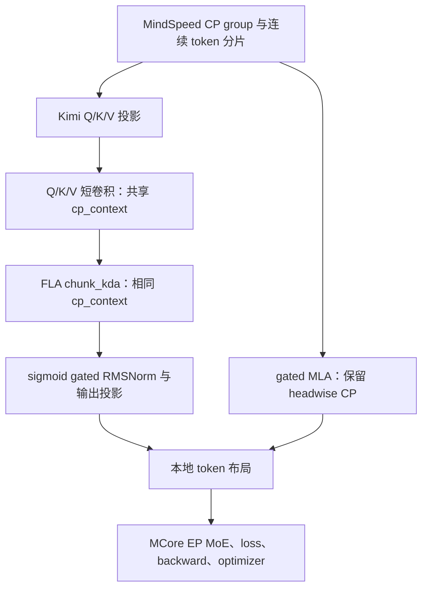

# Kimi K3 在 Ascend 上接入 FLA chunkwise CP

本文说明如何在已有 Kimi 训练工程中，使用 MindSpeed/Megatron-Core 的并行组调用 FLA KDA chunkwise context parallelism，并说明 Ascend 卷积优化的实现与验证结果。代码分别提交到 **[MindSpeed PR #2](https://github.com/Ascend-TechDev/MindSpeed/pull/2)** 和 **[FLA PR #1711](https://github.com/fla-org/flash-linear-attention/pull/1711)**。

接入目标是让 KDA 按连续 token 分段计算，同时让 gated MLA 保留原有 headwise CP。使用者需要已有的 Kimi 模型、配置、权重转换和训练入口；MindSpeed PR 提供可调用的 attention 适配示例及测试。

## 1. 两个 PR 的分工与依赖

| PR | 目标仓库 / 分支 | 提交内容 | 解决的问题 |
| --- | --- | --- | --- |
| [MindSpeed #2](https://github.com/Ascend-TechDev/MindSpeed/pull/2) | `Ascend-TechDev/MindSpeed:master` | 接入文档、模型侧 attention 示例、CP2 与重计算测试 | 把框架 CP group、连续 token 布局、Kimi 参数与 FLA CP API 连接起来 |
| [FLA #1711](https://github.com/fla-org/flash-linear-attention/pull/1711) | `fla-org/flash-linear-attention:main` | scalar 卷积数值修复、带初始状态的 coregrid 路径、算子回归测试 | 消除额外 BF16 舍入，并避免 CP 卷积因 `initial_state` 而整段进入 scalar 路径 |

截至 2026-11-10 核验，两个 PR 均为 **Draft，尚未合入**。阅读和复现时应核对 PR 的实际提交；后续状态以 PR 页面为准。FLA PR 通过个人 fork 提供来源分支，目标仍是上述 FLA 上游 `main`。

此前已合入的 [FLA #1558](https://github.com/fla-org/flash-linear-attention/pull/1558) 提供 Ascend CP 状态预处理、合并及反向内核，合入提交为 `86c2eaed4dc7520455e377732f6615c0cba9ee34`。本次两个 PR 在这项底层能力之上完成模型接入和卷积优化，不重复提交已合入的 CP backend。

MindSpeed #2 依赖 FLA 已有的 CP API，FLA #1711 为这条调用路径补充卷积数值修复与性能优化。是否具备快速卷积路径，取决于实际加载的 FLA 版本。仅包含 #1558，不代表已经包含 #1711。

| 组件 | 承担的职责 |
| --- | --- |
| MindSpeed/MCore | CP/EP 并行组、数据分片、参数梯度归约、MoE dispatch、重计算、优化器 |
| MindSpeed #2 的模型示例 | Kimi 投影和门控语义、CP context 构建、卷积与 KDA 调用、输出布局 |
| FLA CP 与 #1711 | 卷积历史和 KDA 状态通信及其梯度、Ascend 卷积数值与执行路径 |
| Triton/CANN | 编译、执行 NPU 内核以及异步 workspace 生命周期管理 |

## 2. MindSpeed #2：把 KDA 接入训练的数据流

主要实现见 [attention.py](../../../examples/kimi_chunkwise_cp/attention.py)，验证见 [test_kimi_chunkwise_cp.py](../../../tests_extend/unit_tests/mindspeed/core/context_parallel/test_kimi_chunkwise_cp.py)。示例不会注册全局 attention 替换，也不会自动安装 FLA 或修改训练入口。



### 2.1 CP context 同时传给卷积与 KDA

`kda_attention_chunkwise(x, attention, config, cp_group)` 接收 `[1, local_tokens, hidden_size]`。每个 CP rank 持有连续且等长的 token 区间，保留全部 KDA heads；rank 顺序必须对应 token 区间顺序。

适配函数使用框架 CP group、全局边界 `[0, local_tokens × cp_size]` 和源模型卷积宽度构建 `build_cp_context`，同时传入 CPU 与设备端边界。Q/K/V 三个 `causal_conv1d` 和后续 `chunk_kda` 共享该 context，使卷积历史与递推状态都能跨 rank 传播。只给 KDA 传 context，会遗漏 rank 边界的卷积历史。

投影保留 `q/k/v_proj`、`q/k/v_conv1d`、`f_a_proj`、`f_b_proj`、`b_proj`、`A_log`、`dt_bias`、`g_proj`、`o_norm`、`o_proj` 的源模型语义。短卷积从 `[channels,1,width]` 提取权重；配置读取 `linear_attn_config` 和 `rms_norm_eps`。

`beta` 投影先转 FP32，再由 KDA 应用 sigmoid；`raw_g`、`A_log`、`dt_bias` 与 `gate_lower_bound` 一起传入，启用 Q/K L2 normalization 和原始 gate 转换。输出经过 sigmoid 门控 RMSNorm 与输出投影，恢复本地 token 布局。

### 2.2 在已有 Kimi 模型中调用

```python
from megatron.core import parallel_state
from examples.kimi_chunkwise_cp.attention import kda_attention_chunkwise

output = kda_attention_chunkwise(
    local_hidden_states,
    attention_module,
    kimi_config,
    parallel_state.get_context_parallel_group(),
)
```

在 KDA 层的模型分支中选择该函数，gated MLA 继续调用原实现。KDA 函数输入输出均为本地连续 token，不应在函数外再包一层 head/sequence all-to-all。

历史两层训练工程通过自己的 `--kimi-kda-cp-mode headwise|chunkwise` 选择路径。该参数属于调用工程，**MindSpeed #2 没有将其注册为框架全局开关**。迁移到其他训练入口时，需要显式连接模型工厂或 attention forward 分支。

### 2.3 与 headwise CP 的关系

| 路径 | 每个 rank 的 KDA 计算范围 | 跨 rank 处理 |
| --- | --- | --- |
| headwise CP | 完整序列、部分 heads | head/sequence all-to-all，计算后交换回本地 token |
| FLA chunkwise CP | 连续局部序列、全部 heads | 卷积边界历史、KDA 递推状态及反向梯度 |

历史实验保留 `--context-parallel-algo ulysses_cp_algo`，用于现有连续分片与 gated MLA 路径；KDA 是否走 chunkwise 由模型分支决定。保留这一框架参数不表示 `chunk_kda` 内部执行 Ulysses all-to-all。

## 3. FLA #1711：修复并加速带初始状态的卷积

该 PR 修改 `fla/modules/causal_conv1d/backends/triton_ascend.py` 和 `tests/modules/test_conv.py`，保留两个顺序相依的 commit。公开 API、状态布局和数值测试阈值不变。

| 提交 | 作用 |
| --- | --- |
| `0bf84866ddfe9a08a46026af58cf6a5b092eead2` | 修复 scalar 路径的激活与 residual 舍入顺序 |
| `a695c74ce4cfb80461cb93cb04021d30476365a7` | 在上述正确性基线上启用 stateful coregrid，并补充边界与缓存回归测试 |

### 3.1 scalar 路径的数值修复

旧路径先把 FP32 卷积累加结果写为 BF16，再执行 SiLU 和 residual，带来额外舍入。修复后顺序为：**FP32 累加 → SiLU → residual 相加 → 最终低精度写回**，与既有参考精度顺序一致。

四个新增用例覆盖 dense/varlen、带/不带 residual，并检查输出及全部支持的梯度。未修复上游输出相对 RMS 约为 0.0028–0.0030，超过原有 0.001 阈值；修复后通过，未放宽容差。

### 3.2 为什么 initial_state 会导致慢路径

CP 非首 rank 需要前一段序列的卷积历史。旧 Ascend 后端只要遇到 `initial_state` 就禁用 coregrid，整段本地序列转入 scalar。以 256K、CP16 为例，每 rank 的 16384 个 token、12288 个通道都会受到影响，虽然历史贡献仅涉及每段最前面的 W−1 个输出。

### 3.3 coregrid 优化如何实现

1. 复用已有 coregrid 内核处理序列主体。
2. 单独重算每段最前面的 W−1 个输出，补上初始历史贡献及其激活结果。
3. 反向补充历史对应的权重梯度，计算初始状态梯度，并归约 FP32 权重梯度。
4. stateful backward 按当前调用重算 pre-activation，避免同一个输入 tensor 配不同历史时误用缓存。

快速路径要求支持的连续布局、通道分块条件及 W≤4。非连续状态、带 final-state gradient 等不支持的情况继续回退；前向 final state 与反向状态语义保持不变。该 PR 保留当前上游的 masked-address 实现，没有重新引入已移除的 block pointer 路径。

## 4. 版本选择、训练配置与限制

两个 PR 的基线分别为 MindSpeed `c5a72765f99fd8470362c7afdc2cdffe0ab5aea6`、FLA `b8da4873fa0834849b64938af9f89bc35a347d90`。PR 尚未合入时，可在各自的独立仓库工作区获取评审分支：

```bash
# 在 MindSpeed 仓库内
git fetch https://github.com/Ascend-TechDev/MindSpeed.git pull/2/head:review/kimi-chunkwise-cp
git switch review/kimi-chunkwise-cp

# 在 FLA 仓库内
git fetch https://github.com/fla-org/flash-linear-attention.git pull/1711/head:review/ascend-stateful-conv
git switch review/ascend-stateful-conv
```

上述命令只获取 PR 代码。完整运行仍需要匹配的 torch-npu、Triton/CANN、HCCL、已有模型与 checkpoint；获取两个分支不等于最新组合已完成训练验证。

### 4.1 旧版 runtime 的独立兼容问题

历史环境使用 torch `2.10.0+cpu`、torch-npu `2.10.0.post6`、Triton-Ascend `3.2.2` 和 CANN `9.2.beta.2`。其 legacy launcher 存在异步任务执行前 workspace tensor 所有权释放的问题，实验通过 retained allocator 和 task queue 回调保留 owner。兼容层显式启用，要求 `TRITON_ENABLE_TASKQUEUE=true`，并校验 launcher 模板。

这项旧环境兼容层没有随两个 PR 自动安装。升级 runtime 后应重新验证 workspace 生命周期和 WY/KDA 结果，不能无条件沿用旧模板替换。

另外，FLA `b8da4873` 的公共 Ascend `chunk_delta_h` 包含当前 Triton-Ascend 3.2 不支持的链式布尔表达式，完整 KDA 调用会在编译阶段报 `UnsupportedLanguageConstruct`。该文件未被 #1711 修改。新基线卷积测试通过，不能据此判断该 runtime 下完整 KDA 也已通过。

### 4.2 已验证的训练配置

历史实验提取 Kimi 原模型第 2 层 KDA、第 3 层 gated MLA，映射为训练层 0、1；保留每层 896 个路由专家、top-16、两个共享专家、latent MoE、SiTU 和 AttnRes。反量化真实权重通过 MCore `torch_dist` checkpoint 严格加载。

| 参数 | 历史两层实验配置 |
| --- | --- |
| 并行 | TP1 / PP1 / ETP1 / CP16 / EP16 / DP1 |
| 全局序列 / 每 rank token 数 | 262144 / 16384 |
| KDA heads / head dimension / 卷积宽度 | 96 / 128 / 4 |
| `--micro-batch-size` | 1 |
| `--global-batch-size` | coregrid 为 8；较早 scalar、headwise 对照为 16 |
| CP 框架配置 | `--context-parallel-size 16 --context-parallel-algo ulysses_cp_algo` |

DP=1、MBS=1 时，GBS=8 表示每步累积 8 个 microbatch；GBS=16 表示累积 16 个。不能将其改写为 `--micro-batch-size 8/16`。

数据使用 WikiText 原始文本，经 Kimi tokenizer 和 EOS 分隔连续拼接，再循环采样以满足 profiling 步数。它用于测量执行性能，不用于评估预训练质量；不同 microbatch 不必是同一条序列。

### 4.3 当前接入契约

- 一次 microbatch 是一条非空连续序列，各 CP rank 等长；当前示例不支持 MBS>1、packed 多文档边界或 zigzag 分片。
- CP context 按 token 数、卷积宽度、device 和 group 缓存。扩展 packed/varlen 数据时，必须传入真实全局边界并把边界纳入缓存契约。
- 显式传入框架已初始化的 CP group；销毁并重建 group 时应清理 `_context` 缓存，避免使用旧 group。
- TP/PP 等其他拓扑、参数映射、loss normalization、参数梯度同步与 optimizer resume 需要由调用工程适配和验证。两个 PR 不提供完整 Kimi trainer、权重、数据集或原始 profiler 文件。

## 5. 验证范围与复现方法

| 验证对象 | 实测结果 | 对应版本与结论范围 |
| --- | --- | --- |
| MindSpeed #2 attention 示例 | 两卡每 rank 6 passed | FLA `98193113ecb7835143252a786e06933e371b67cc` 加当时卷积修改和旧 runtime 兼容层；小规模随机权重 |
| FLA #1711 scalar 修复 commit | 114 passed / 162 skipped | 新基线 `b8da4873` 上的卷积测试 |
| FLA #1711 coregrid commit | 120 passed / 162 skipped | 同一新基线，包含生产尺寸、短 varlen、FP32/FP16/BF16、dense tail 和共享输入不同历史 |
| 更广泛 dependent tests、最新组合完整训练 | 尚未全部完成 | 保持 Draft；不能用历史训练替代当前组合验证 |

卷积跳过项需要 CUDA、Gluon 或 Blackwell 硬件/依赖；当前基线的分布式卷积测试会跳过 NPU，这些 skips 不构成 NPU CP 验证。较早基线上的部分依赖测试为 27 passed / 42 skipped，也不等价于新基线的完整依赖测试通过。

配置好对应环境后，在 MindSpeed 仓库根目录运行：

```bash
FLA_CI_ENV=0 ASCEND_RT_VISIBLE_DEVICES=0,1 \
torchrun --standalone --nproc-per-node=2 -m pytest \
  tests_extend/unit_tests/mindspeed/core/context_parallel/test_kimi_chunkwise_cp.py -q
```

测试比较 CP2 与 CP1 的输出、输入梯度及 CP all-reduce 后的全部参数梯度；覆盖普通 backward、reentrant checkpoint、非法输入和缺失 CP group。checkpoint 检查 attention 实际执行一次前向、一次重计算。

在 FLA 仓库根目录运行卷积验证：

```bash
python scripts/find_dependent_tests.py fla/modules/causal_conv1d/backends/triton_ascend.py
FLA_CI_ENV=0 python -m pytest tests/modules/test_conv.py -q --tb=short
```

`FLA_CI_ENV=0` 保留 NaN allocation poisoning 和现有容差。接入完整模型后，还应验证真实权重、headwise/chunkwise 全梯度对照、实际重计算、HCCL、EP MoE、loss、grad norm 和 optimizer step。reentrant checkpoint 需要通过 `backward()` 验证。

## 6. 性能收益：卷积微基准与历史完整训练

### 6.1 FLA #1711 的同卡卷积微基准

比较对象为 scalar 修复 commit `0bf84866` 和 coregrid commit `a695c74c`。两者使用同一物理 NPU、相同软件与输入：BF16 `[1,16384,12288]`、FP32 权重 `[12288,4]`、BF16 初始历史、SiLU；varlen 为单段 `[0,16384]`。同步计时，排除 2 次预热，取 5 次测量中位数。

| 场景 | 修复后的 scalar，forward+backward | coregrid，forward+backward |
| --- | ---: | ---: |
| Varlen，带初始状态 | 3029.853 ms | 8.881 ms |
| Dense，带初始状态 | 3036.631 ms | 8.987 ms |
| Varlen，无初始状态 | 7.300 ms | 7.099 ms |

带状态的卷积 API 分别加速约 341.2 倍和 337.9 倍。无状态路径未改变，其小幅差异不作为收益声明。未修复上游的新增数值用例失败，因此性能基线选用已修复 scalar；scalar 数值修复本身相对原上游的耗时差异未测量。复现脚本和逐次样本见 [FLA #1711 的 Benchmark 部分](https://github.com/fla-org/flash-linear-attention/pull/1711)。

### 6.2 历史 CP16 / 256K 完整训练

下表来自较早冻结环境：MindSpeed `b562c149e771c368565bf2e29de8f54028764993`、MindSpeed-LLM `bc4e91cc6d344937df4d2f36f6ac26828051482c`、Megatron-LM `a845aa7e12b3a117e24c2352b9e3e60bad2e3a17`、FLA `f2ca71c0afb3254b564471e152e73ba5d1cddcaa` 加当时的 CP/卷积补丁。它不是两个 PR 当前新基线的完整训练结果。

| 路径 | 每步 microbatch 数 | 三个采样步骤的平均单步 | 单步时间除以 microbatch 数 |
| --- | ---: | ---: | ---: |
| chunkwise scalar | 16 | 743.003 s | 46.438 s |
| chunkwise coregrid | 8 | 273.416 s | 34.177 s |
| headwise | 16 | 546.390 s | 34.149 s |

归一化后，coregrid 相对 scalar 每 microbatch 用时约降低 26.4%，与 headwise 接近。由于 global batch、采样步骤和固定开销不同，该结果不能替代严格同配置 A/B，也不能将单卷积的数百倍收益作为整步训练加速比。

历史 coregrid 训练完成 6 步，使用 `--train-iters 6 --profile-step-start 4 --profile-step-end 7` 采第 4–6 步；end 是排他上界，训练停止由 `train-iters` 控制。16 rank 已导出，但部分 attention PMU 有缺口。训练完成、时间线可分析与全部 PMU 齐全应分别核验。

两个 PR 的代码审阅、数值测试和性能证据可通过文首链接追踪。部署前仍需在选定的 FLA、Triton/CANN 和训练框架组合上完成完整模型验证。
