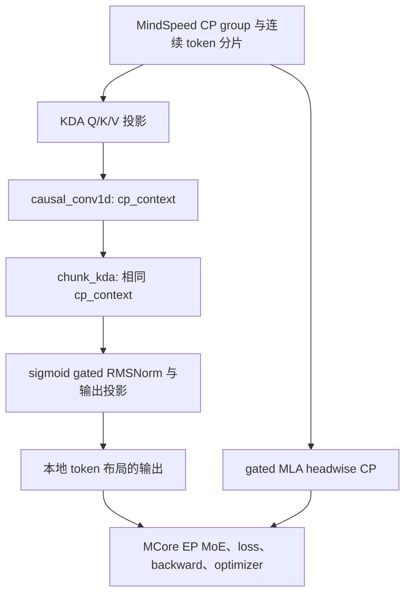

# Kimi KDA 接入 FLA chunkwise CP

本文说明在 MindSpeed/Megatron-Core 的并行训练中如何调用 FLA KDA chunkwise context parallelism，并提供[模型侧适配示例](../../../examples/kimi_chunkwise_cp/attention.py)。示例需要调用者已有的 Kimi attention 子模块和配置；它不提供完整 Kimi 模型、权重转换或训练入口，不会默认安装任何全局 patch。

## 问题与职责划分

[FLA #1558](https://github.com/fla-org/flash-linear-attention/pull/1558) 已提供 Ascend 上的 CP 状态预处理、合并及其反向内核。包含该合入提交 `86c2eaed4dc7520455e377732f6615c0cba9ee34` 的 FLA 可以提供底层能力，但训练工程仍需连接模型参数、token 布局、并行 group、卷积历史和反向过程。

| 组件 | 职责 |
| --- | --- |
| MindSpeed/MCore | 创建 CP/EP 等并行 group、数据分片、参数梯度归约、MoE dispatch、重计算和优化器 |
| 模型适配 | 保留 Kimi 投影、门控和归一化语义，将同一个 CP context 传给卷积和 KDA |
| FLA | 卷积边界历史、KDA 递推状态的跨 rank 通信及其梯度，Ascend 算子实现 |
| Triton/CANN | 编译和执行 NPU 内核，管理异步执行中的 workspace 生命周期 |

KDA headwise CP 将完整序列的部分 heads 分配给各 rank；chunkwise CP 则在每个 rank 上保留全部 heads，处理连续的一段 token。混合模型可以让 KDA 使用 chunkwise，同时让 gated MLA 保持原有 headwise 路径。

## 方案与调用关系



`kda_attention_chunkwise(x, attention, config, cp_group)` 接收 `[1, local_tokens, hidden_size]` 输入。CP rank 顺序必须与连续 token 区间顺序一致，每个 rank 的 token 数相等。

适配函数用全局边界 `[0, local_tokens × cp_size]` 构建 `build_cp_context`，指定源模型的卷积宽度，同时提供 CPU 和设备端边界。该 context 同时传给 Q/K/V 三个短卷积和 `chunk_kda`。只给 KDA 传 context 会丢失非首 rank 的卷积历史。

KDA 调用开启 Q/K L2 normalization、原始 gate 转换和 beta sigmoid。`beta` 投影输出先转 FP32；`raw_g`、`A_log`、`dt_bias` 和源模型 `gate_lower_bound` 一起传入内核。输出采用 sigmoid 门控 RMSNorm，再执行输出投影。

示例保持现有 Kimi 参数名称：`q/k/v_proj`、`q/k/v_conv1d`、`f_a_proj`、`f_b_proj`、`b_proj`、`A_log`、`dt_bias`、`g_proj`、`o_norm` 和 `o_proj`。卷积权重来自 `[channels,1,width]` 的 depthwise Conv1d。配置需要 `linear_attn_config` 和 `rms_norm_eps`。

## 在已有模型中使能

从框架获取 CP group，显式传给适配函数：

```python
from megatron.core import parallel_state
from examples.kimi_chunkwise_cp.attention import kda_attention_chunkwise

output = kda_attention_chunkwise(
    local_hidden_states,
    attention_module,
    kimi_config,
    parallel_state.get_context_parallel_group(),
)
```

调用发生在 KDA attention 所在的模型层。不要在函数外再执行 KDA 的 head/sequence all-to-all；函数输入输出都采用本地连续 token 布局。gated MLA 继续调用已有的 attention 实现。

两层实验工程用模型自己的 `--kimi-kda-cp-mode headwise|chunkwise` 开关选择路径。这不是本 PR 注册的 MindSpeed 全局参数。接入其他训练入口时，应在模型工厂或 attention forward 分支中显式选择上述函数，并保持 headwise 为原来的默认行为。

混合模型的现有实验使用以下框架参数：

```text
--context-parallel-size 16
--context-parallel-algo ulysses_cp_algo
--expert-model-parallel-size 16
--expert-tensor-parallel-size 1
--tensor-model-parallel-size 1
--pipeline-model-parallel-size 1
--seq-length 262144
--micro-batch-size 1
--global-batch-size 8
```

保留 `ulysses_cp_algo` 是为了现有连续数据分片与 gated MLA；KDA 的选择由模型分支决定。它不表示 `chunk_kda` 内部走 Ulysses all-to-all。

## 支持范围与限制

- 一次 microbatch 只有一条连续序列，且每 rank 长度相等。不支持 MBS>1、packed 文档边界或 zigzag 布局。
- CP context 按 token 数、卷积宽度、device 和 group 缓存；若扩展为真实多文档 `cu_seqlens`，必须把边界纳入 context 和缓存契约。不能用 `[0,total]` 代替文档边界。
- 显式传入已初始化的框架 CP group，避免误用默认 world group。若在同一进程销毁并重建并行 group，应先清理示例的 `_context` 缓存。
- 完整两层实验只验证 TP1/PP1/ETP1/CP16/EP16/DP1；其他拓扑需要单独适配和验证。
- 参数映射、checkpoint 严格加载、loss normalization、参数梯度同步和 optimizer resume 由调用工程负责。示例不实现这些训练能力。

在 DP=1、MBS=1 时，GBS=8 表示每个优化器步骤累积 8 个 microbatch，GBS=16 表示 16 个。不能把梯度累积次数误写成 `--micro-batch-size 8`。

## Ascend 兼容性与 FLA 优化

### 卷积数值顺序

旧 scalar convolution 路径把 FP32 卷积累加值先写成 BF16，再执行 SiLU / residual，导致额外舍入。FLA 的独立修复将二者放到最终低精度写回之前，保持现有参考精度和阈值。修复属于 FLA 卷积后端，不应通过 MindSpeed 的全局 monkey patch 覆盖 FLA 算子。

### 带初始状态的卷积

CP 非首 rank 会收到卷积历史。旧 Ascend 后端遇到 `initial_state` 就禁用 coregrid，整段本地序列进入 scalar 路径。独立 FLA 优化使用 coregrid 计算主体，并修正每段最前面的 W−1 个输出及权重、状态梯度。stateful backward 按调用重算 pre-activation，避免同一个输入配不同历史时误用缓存。

该优化保持公开 API，快速路径仅接受支持的连续布局和 W≤4；不支持的情况继续回退。是否包含该优化应检查实际 FLA commit 和源码，不能仅凭存在 #1558 判断。

### 旧版 Triton runtime

历史环境使用 Triton-Ascend 3.2.2。其 legacy workspace 分配路径存在异步任务执行前 tensor 所有权释放的问题，实验使用显式启用的兼容层，通过 retained allocator 和 task queue 回调保留 owner。它要求 `TRITON_ENABLE_TASKQUEUE=true`，并检查 launcher 模板版本。

该兼容层是旧环境专用的运行时处理，不随本示例自动安装。优先使用已修复且经过验证的运行时；如复现旧环境，需独立验证 workspace 生命周期和 WY/KDA 结果。升级后不能无条件保留旧 launcher 字符串替换。

版本不能只按“最新”选择。本次测试发现，FLA `b8da4873fa0834849b64938af9f89bc35a347d90` 的公共 Ascend `chunk_delta_h` 内核包含当前 Triton-Ascend 3.2 编译器不支持的链式布尔表达式，KDA 调用在编译阶段报 `UnsupportedLanguageConstruct`。这与本示例的模型参数连接、卷积补丁是不同问题。旧环境的示例验证使用 FLA `98193113ecb7835143252a786e06933e371b67cc` 加卷积修复；升级到较新 FLA 时应重新验证匹配的 Triton/CANN 组合。

## 验证方法

在配置好 torch-npu、FLA 和 HCCL 后，从仓库根目录运行：

```bash
FLA_CI_ENV=0 ASCEND_RT_VISIBLE_DEVICES=0,1 \
torchrun --standalone --nproc-per-node=2 -m pytest \
  tests_extend/unit_tests/mindspeed/core/context_parallel/test_kimi_chunkwise_cp.py -q
```

此测试比较 CP2 与完整序列 CP1 的输出、输入梯度，以及 CP all-reduce 后的全部参数梯度；同时检查 reentrant checkpoint 实际调用两次 attention。另检查非法 batch、空序列和缺失 CP group。测试采用小规模随机权重，不能替代完整模型验证。

接入真实模型后，仍需检查真实权重、headwise/chunkwise 全梯度对照、实际重计算路径、HCCL、EP MoE、loss、grad norm 和 optimizer step。reentrant checkpoint 应使用 `backward()` 验证，不能只跑未经过重计算的 `autograd.grad()` 算子测试。

profiling 起止与训练停止相互独立：历史训练使用 `--train-iters 6 --profile-step-start 4 --profile-step-end 7` 采第 4–6 步，end 是排他上界。每个 rank 的时间线、通信导出、PMU 完整性要分别检查。

## 历史两层训练结果

实验提取原模型第 2 层 KDA 和第 3 层 gated MLA，保留每层 896 个路由专家、top-16、两个共享专家、latent MoE、SiTU 和 AttnRes。全局序列 256K，CP16 时每 rank 16384 token，KDA 96 heads、head dimension 128、卷积 width 4。数据使用 WikiText 文本经 Kimi tokenizer 连续拼接和循环采样，仅用于 profiling。

冻结环境为 MindSpeed `b562c149e771c368565bf2e29de8f54028764993`、MindSpeed-LLM `bc4e91cc6d344937df4d2f36f6ac26828051482c`、Megatron-LM `a845aa7e12b3a117e24c2352b9e3e60bad2e3a17`，FLA `f2ca71c0afb3254b564471e152e73ba5d1cddcaa` 加当时的 CP / 卷积补丁。torch 2.10.0+cpu、torch-npu 2.10.0.post6、triton-ascend 3.2.2，CANN 9.2.beta.2。这些是历史训练版本，不等于当前仓库所有组件都已重新跑过同一训练。

| 路径 | 每步 microbatch 数 | 三个采样步骤的平均单步 | 除以 microbatch 数 |
| --- | ---: | ---: | ---: |
| chunkwise scalar | 16 | 743.003 s | 46.438 s |
| chunkwise coregrid | 8 | 273.416 s | 34.177 s |
| headwise | 16 | 546.390 s | 34.149 s |

归一化后，coregrid 相对 scalar 每个 microbatch 耗时约降低 26.4%，与 headwise 接近。由于 batch、采样步骤和固定开销不同，该表不能替代严格同配置 A/B；更不能把单卷积微基准的数百倍收益当作全训练加速比。

coregrid 历史训练完成 6 步并导出了 16 rank 采集数据，但部分 attention PMU 有缺口。训练完成、时间线可分析和全部 PMU 完整是三个不同结论。
